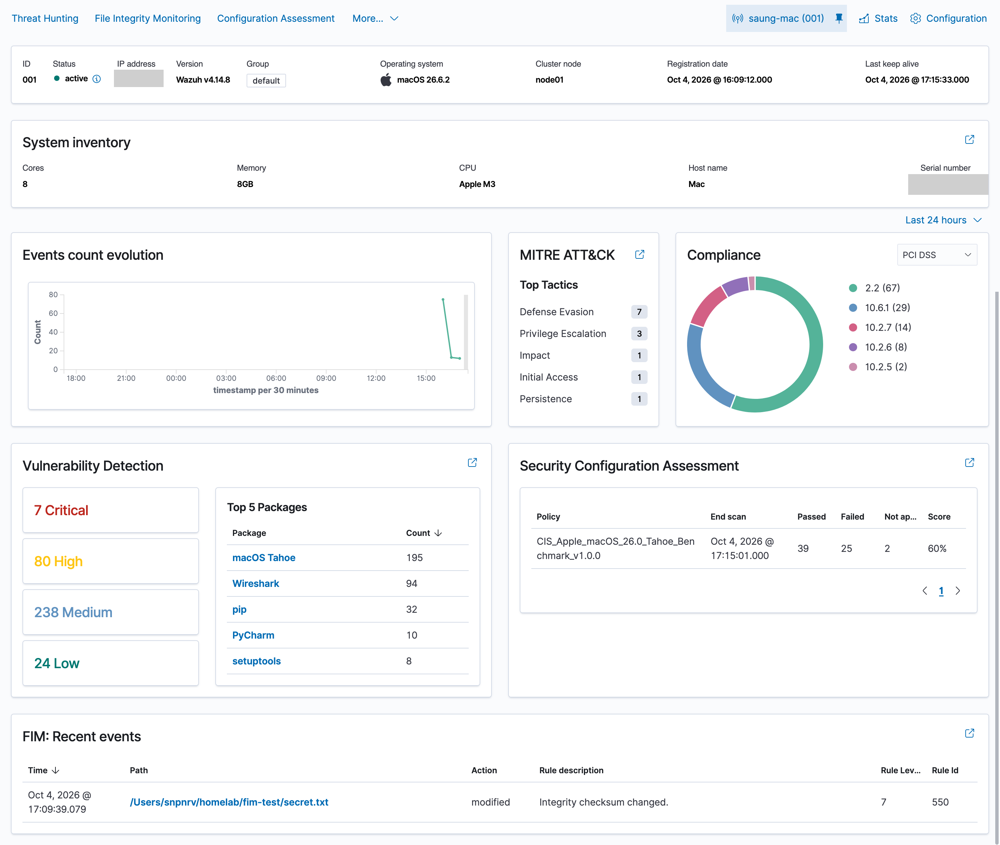
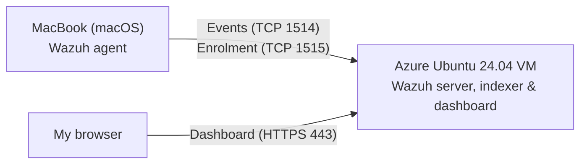
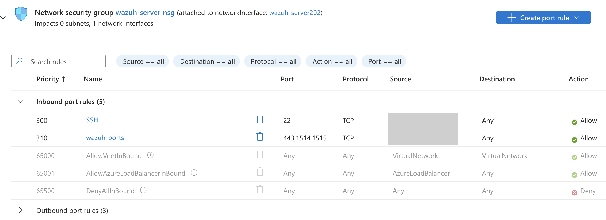
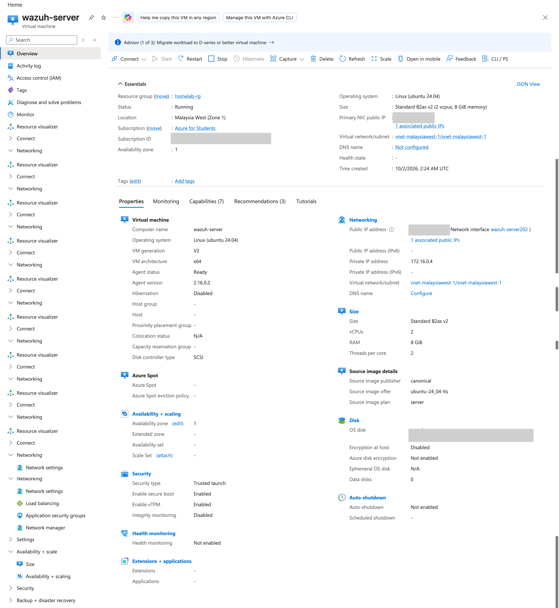
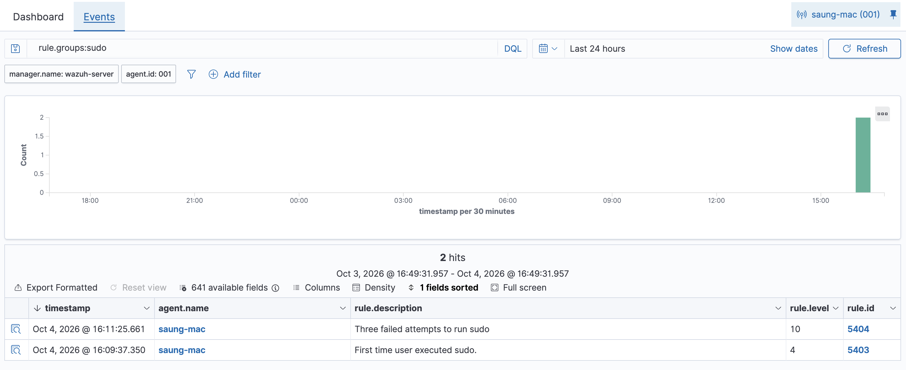
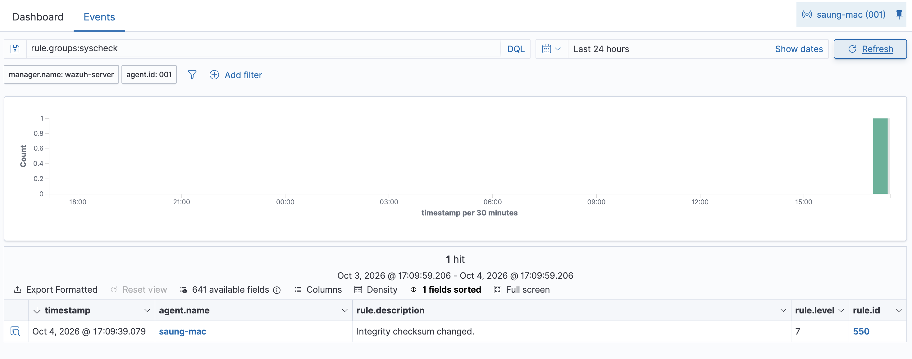

# Home-Lab SIEM with Wazuh on Azure

A home security monitoring lab I built to practise the day-to-day work of a SOC analyst: collecting endpoint logs, generating and investigating alerts, and checking a machine against a security benchmark.

The lab runs a **Wazuh** server on a **Microsoft Azure** Ubuntu VM and monitors my **MacBook (macOS)** through the Wazuh agent.

---

## Architecture

| Component | Details |
|---|---|
| SIEM server | Wazuh all-in-one (server, indexer, dashboard) |
| Host | Azure for Students VM, Ubuntu 24.04, Standard B2as v2 (2 vCPU, 8 GB RAM) |
| Monitored endpoint | MacBook Air (Apple M3), macOS, Wazuh agent v4.14.8 |
| Network security | Azure Network Security Group: SSH (22) and Wazuh ports (443, 1514, 1515) allowed **only from my own IP**; everything else denied |

---

## Setup Summary

1. **Created the VM** on Azure for Students (Ubuntu 24.04) and locked down the Network Security Group so only my IP can reach SSH and the Wazuh ports.
2. **Installed Wazuh** with the official all-in-one installation assistant.
3. **Installed the Wazuh agent on my Mac**, enrolled it with the server, and confirmed it showed as *Active* on the dashboard.
4. **Set up file integrity monitoring (FIM)** on a test folder so file changes raise alerts.

---

## Detection Scenarios

I simulated suspicious activity on my own Mac and checked that Wazuh detected it.

| # | Scenario | What I did | Detected? | Wazuh rule |
|---|---|---|---|---|
| 1 | Privilege use | Ran `sudo` for the first time as my user | ✅ Yes | **5403** (level 4): First time user executed sudo |
| 2 | Brute-force style privilege attempts | Entered the wrong `sudo` password three times | ✅ Yes | **5404** (level 10): Three failed attempts to run sudo |
| 3 | File tampering | Edited a file inside a monitored test folder | ✅ Yes | **550** (level 7): Integrity checksum changed |

### Example investigation: rule 5404 (failed sudo attempts)

- **Alert:** Rule 5404, level 10, "Three failed attempts to run sudo" on agent `saung-mac`, about two minutes after rule 5403 (first sudo use) on the same host.
- **What it could mean:** someone guessing an admin password to gain root access (MITRE ATT&CK: Privilege Escalation).
- **Verdict:** Expected activity. I triggered it myself as a test, so it is a true positive for the rule but not a real threat.
- **In a real SOC I would:** confirm who was at the machine, check whether a *successful* sudo followed the failures, look for other alerts from the same user or host, and escalate if the activity wasn't explained.

---

## What Else the Lab Showed

The dashboard also gave me a security picture of my own laptop:

- **Security Configuration Assessment:** checked the Mac against the **CIS Apple macOS 26 Tahoe Benchmark v1.0.0**. Result: **60%** (39 passed, 25 failed, 2 not applicable). The failed checks are a to-do list for hardening.
- **Vulnerability detection:** flagged known vulnerabilities in installed software (7 critical, 80 high), mostly in the OS and tools such as Wireshark and pip.
- **MITRE ATT&CK mapping:** alerts were grouped by tactic, with Defense Evasion and Privilege Escalation at the top.

---

## Challenges & What I Learned

- **Cloud provider:** I first planned to host the server on Oracle Cloud, but the signup failed, so I moved the lab to Azure for Students.
- **Exposure:** a SIEM dashboard open to the internet is a target, so I restricted every inbound port to my own IP from the start.
- **Reading alerts:** the rule level matters. A first sudo is informational (level 4), but repeated failures (level 10) deserve a look.

---

## Skills Demonstrated

- SIEM deployment and configuration (Wazuh)
- Alert generation, triage and investigation
- File integrity monitoring
- CIS benchmark assessment and vulnerability detection
- Cloud networking and access control (Azure NSG)
- Linux server administration
- Technical documentation

---

## Next Steps

- [ ] Fix some of the 25 failed CIS checks and re-scan to raise the score
- [ ] Write a custom Wazuh rule and test it
- [ ] Add a Windows or Linux endpoint as a second agent
- [ ] Turn on VM auto-shutdown to save student credits

---

## Security Note

This is a personal lab. No passwords, keys, IP addresses, subscription IDs or real organisational data are stored in this repository, and screenshots are redacted.
